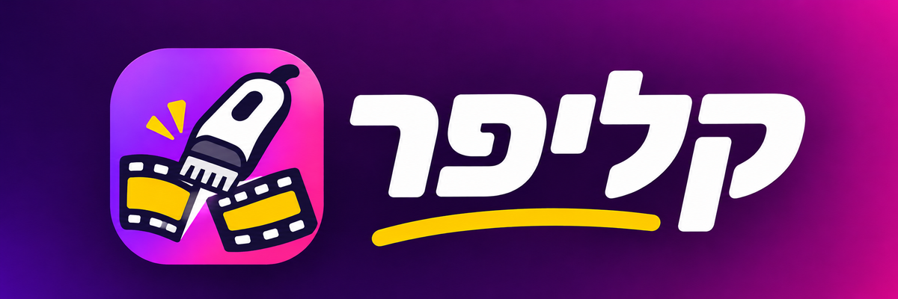

<p align="center"></p>

# קליפר (Kliper)

**הופך את הסטרימים שלך לקליפים לטיקטוק, שורטס ורילס, בעברית.**

מדביקים קישור ל-VOD מ-Kick, ‏YouTube או Twitch (או קובץ וידאו), וקליפר:

- מתמלל את הסטרים בעברית עם מודל של [ivrit.ai](https://huggingface.co/ivrit-ai)
- מוצא את הרגעים הכי טובים לפי הקול, הצ'אט, סלנג ישראלי ("אין מצב", "קלפו", "חחחח") וקליפים של צופים
- עם AI (אופציונלי, מפתח Claude API משלך): קורא את כל הסטרים ומוצא רגעים מצחיקים, וכותב כותרות ותיאורים בעברית
- מסדר מצלמה + משחק בפורמט אנכי 9:16, חותך שתיקות ומוסיף כתוביות בעברית (מימין לשמאל)
- כולל עורך עם ציר זמן, וייצוא למחשב או ישר לטלפון עם קוד QR

הכל רץ על המחשב שלך. כרטיס מסך של NVIDIA מאיץ מאוד, אבל לא חובה.

## התקנה (Windows 10/11, 64-bit)

1. מורידים את `Kliper Setup <גרסה>.exe` מדף ה-[Releases](../../releases/latest).
2. אם Windows מציג "Windows protected your PC", לוחצים **More info** ואז **Run anyway** (קובץ ההתקנה עוד לא חתום).
3. בפעם הראשונה קליפר מוריד את מודל התמלול העברי (כ-1.6GB).

## הרצה מהקוד

```
pip install -r requirements.txt
python engine\run_app.pyw
```
צריך Python 3.11 ו-FFmpeg (ב-`ffmpeg\bin\` או ב-PATH).

## קרדיטים ורישיון

קליפר מבוסס על [Clip Genie](https://github.com/geniestudiofx/clip-genie-open) של xHotGamerDude / Genie Studio FX
(גרסה 0.1.2 Beta), ששוחרר תחת GNU GPL v3. תודה ענקית להם.
קליפר הוא גרסה ששונתה (עברית, Kick, מודל ivrit.ai, ממשק RTL, מיתוג חדש) ומופץ גם הוא תחת **GNU General Public License v3.0**,
ראו [LICENSE](LICENSE). השם "Clip Genie" והלוגו שלו שייכים ליוצר המקורי, וקליפר אינו קשור אליהם רשמית.

רכיבי צד שלישי שומרים על הרישיונות שלהם: pywebview, ‏pythonnet ו-bottle (‏`engine/vendor/`, BSD/MIT), ‏`app/qrcode.js` (MIT),
פונטים ב-`engine/fonts/` וב-`app/` (SIL Open Font License, כולל Rubik, ‏Heebo, ‏Secular One ו-Suez One).
FFmpeg, מודלי Whisper / ivrit.ai (Apache-2.0) וחבילות Python מורדים בנפרד, כל אחד תחת הרישיון שלו.
